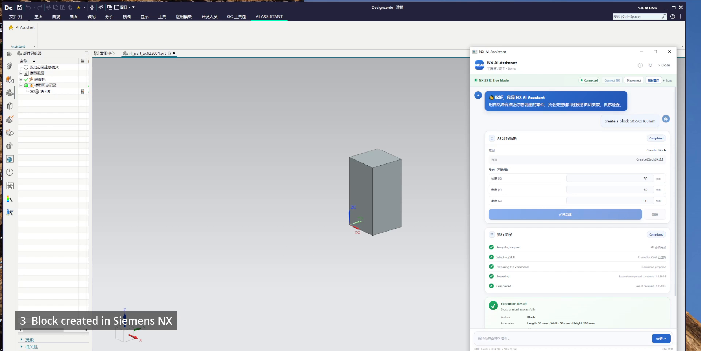

# NX AI Assistant

**Natural Language → Engineering Intent → Skill → Siemens NX**

A product prototype demonstrating how an AI assistant can interpret an engineering request, present structured parameters for review, and create a CAD feature in Siemens NX.

[Watch or download the 30-second demo video](https://github.com/kim2329/NX-AI-Assistant-Public-Demo/releases/tag/v0.1.0-demo)

## Demo

The recording shows one completed workflow in Siemens NX 2512:

- **Input:** “create a block 50x50x100mm”
- **Intent:** Create Block
- **Skill:** CreateBlockSkill
- **Parameters:** 50 × 50 × 100 mm
- **Result:** A block is created and shown in the NX modeling view.

This is a prototype demonstration of a limited workflow. It does not claim support for arbitrary CAD operations or unattended modeling.

## How it works

User request → NX AI Assistant → intent and parameter parsing → Skill → private NX automation runtime → Siemens NX

See [the high-level architecture](docs/architecture-overview.md) and [demo flow](docs/demo-flow.md).

## Public and private boundary

This repository contains product presentation material: a recorded workflow, screenshots, example prompts, and a high-level architecture description.

The core NX automation runtime and production execution components are intentionally not included in this public repository.

No runnable NX integration or implementation source is provided here.

## Current capability

The showcased capability is CreateBlockSkill: interpreting a block request, showing dimensions for confirmation, and creating that block in the recorded NX 2512 session.

## Roadmap

Potential future directions are listed in [roadmap.md](docs/roadmap.md). They are plans, not claims about current capabilities.

## License

Copyright © 2026. All rights reserved. No license to use, copy, modify, or distribute implementation materials is granted by this showcase repository. Siemens and NX are trademarks of Siemens; this project is an independent demonstration.

## Release audit

The public-content review is recorded in [PUBLIC_RELEASE_AUDIT.md](PUBLIC_RELEASE_AUDIT.md).
