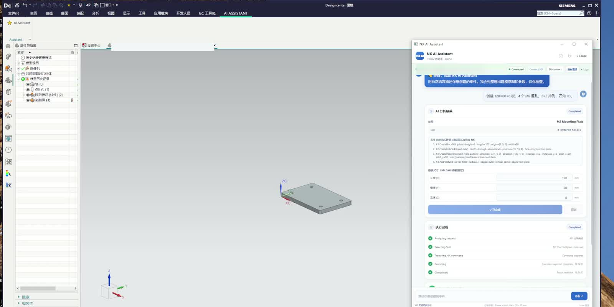
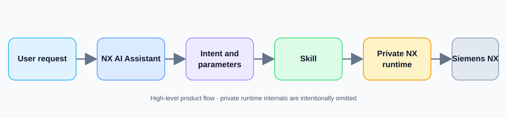

# NX AI Assistant

**Natural-language multi-step modeling for Siemens NX**

Validated on **NX 2512.1700**

[Watch or download the 13-second M2 showcase video](assets/demo-preview/NX_AI_Assistant_M2_demo_showcase.mp4)

## M2 workflow

**Natural-language request → Preview → CreateBlock → CreateHole → PatternHole → FilletEdges → Confirm → Real NX execution**

The request is reviewed as an ordered Skill plan before confirmation. The confirmed plan creates a real part in Siemens NX.

## M2 fixture

- 120 × 80 × 8 mm plate
- Four Ø6 through holes in a deterministic 2 × 2 layout
- Four R3 corner fillets

## What M2 proves

- An inspectable, ordered Skill plan
- Human confirmation before model mutation
- Typed feature dependency from the seed hole to its pattern
- Real NX execution
- Independent geometry verification

## Validation

- M2-L1 Real NX Modeling Core: PASS
- M2-L2 Windows/WebView UI E2E: CANDIDATE_PASS

The full M2 UI E2E is **not** claimed as PASS.

## Architecture

The diagram names public-facing stages and the execution boundary only. It does not expose Platform or Agent implementation details.

## Limitations

- The public demo exposes a limited modeling workflow.
- It is not yet a general-purpose natural-language CAD system.
- Supported and tested NX version: **NX 2512.1700**.

## Public/private boundary

This repository is a presentation showcase. It contains documentation and reviewed demo media, not the private Platform or Agent implementation, proprietary automation or SDK implementation, private evidence records, or deployment materials.

## License

Copyright © 2026. All rights reserved. No license to use, copy, modify, or distribute implementation materials is granted by this showcase repository. Siemens and NX are trademarks of Siemens; this project is an independent demonstration.

See [PUBLIC_RELEASE_AUDIT.md](PUBLIC_RELEASE_AUDIT.md) for the public-content review.
