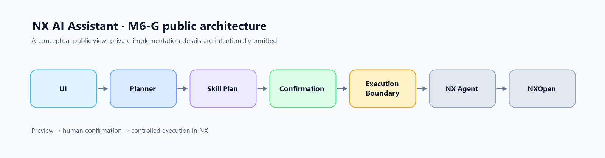

# M6-G Public Architecture

The public-facing workflow is:

**UI → Planner → Skill Plan → Confirmation → Execution Boundary → NX Agent → NXOpen**

The diagram shows named stages only. It does not describe private Platform internals, Agent implementation details, service topology, or proprietary automation and SDK code.

M6-G demonstrates a bounded natural-language Goal reaching real NX execution. The public repository provides this conceptual view and showcase media; it does not contain the private runtime.
