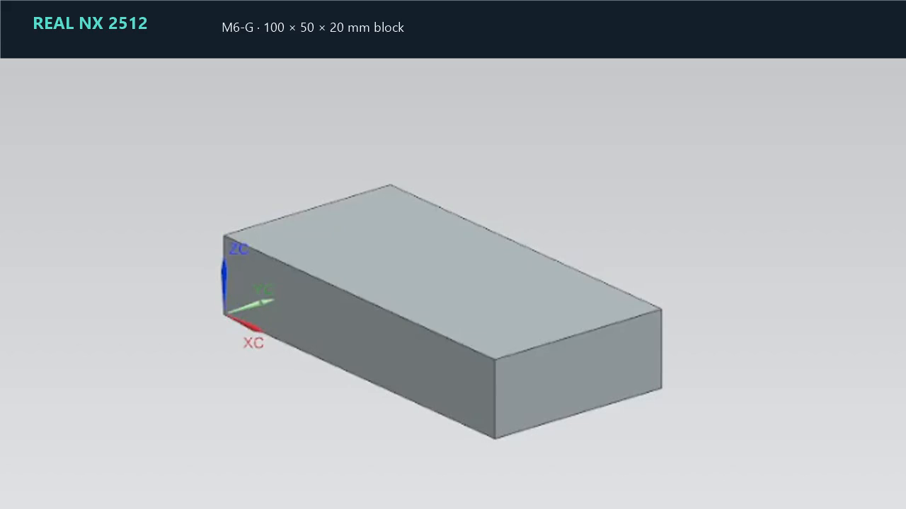

# M6-G Showcase

M6-G is the frozen real-NX milestone presented by this public demo.

## Demonstrated Goal

> Create a 100 × 50 × 20 mm block.

The milestone demonstrates a natural-language Goal resulting in a Block feature in real Siemens NX 2512, followed by independent geometry verification.

## Video

The edited clip pairs a title card with the final NX model viewport. It omits desktop and recorder overlays, the NX startup screen, local run labels, the part-tab name, audio, and source metadata.

## What the milestone proves

- Real NX 2512 execution
- Natural-language Goal handling for the fixed demo request
- CAD feature creation
- Independent geometry verification

The public repository contains only the summary and reviewed presentation assets. It does not contain raw evidence records, execution logs, or the private implementation.

## Limitations

- The demonstrated workflow is limited to the fixed Block Goal.
- It is not a general-purpose natural-language CAD system.
- Reproducing a live run **requires local NX2512 environment** and the private runtime, which is not included here.
